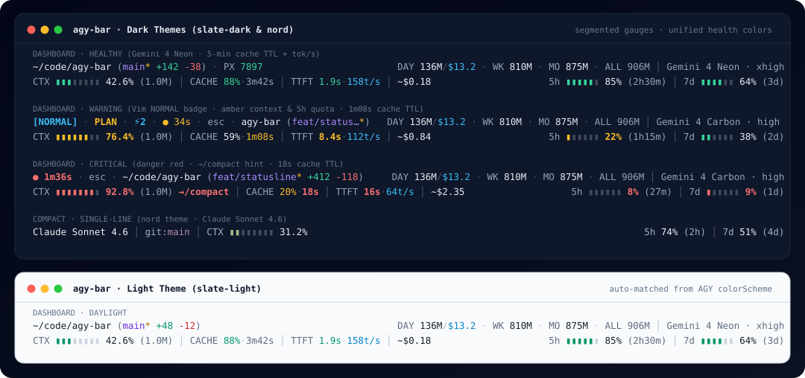
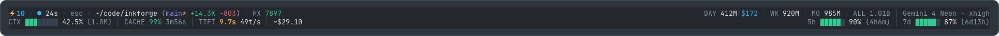
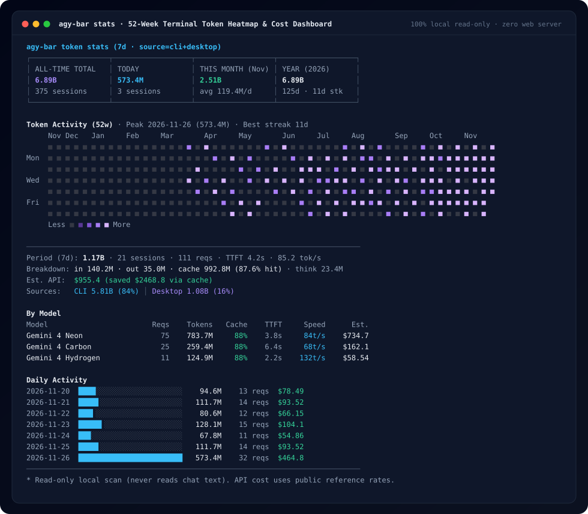
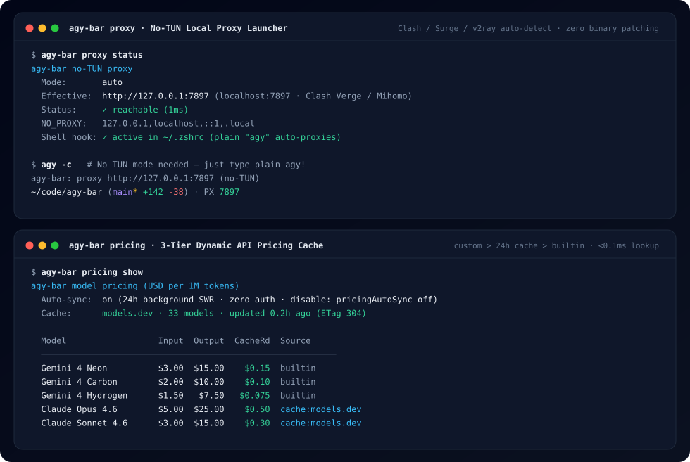

<div align="center">

# agy-bar

**Zero-dependency statusline HUD, native 6-state tab titles, no-TUN local proxy launcher, 52-week token heatmap & multi-CLI monitor for Antigravity CLI (`agy`)**

**English** | [简体中文](./README.zh-CN.md) | [AI Agent Install Guide (`AGENTS.md`)](./AGENTS.md) | [Machine-Readable Index (`llms.txt`)](./llms.txt)

[](https://github.com/xy-tuoren/agy-bar/actions/workflows/ci.yml)
[](https://www.npmjs.com/package/agy-bar)
[](https://www.npmjs.com/package/agy-bar)
[](https://nodejs.org/)
[](#)
[](./LICENSE)

</div>



```sh
# Install in one command (Node.js >= 20, zero dependencies, macOS / Linux / Windows)
npx -y agy-bar@latest install
```

> **Let your AI agent install it for you** — paste into `agy`, Claude Code, or Codex:
> ```text
> Follow https://raw.githubusercontent.com/xy-tuoren/agy-bar/main/AGENTS.md to install agy-bar for me.
> ```

---

## Why `agy-bar`?

Antigravity CLI (`agy`) ships with a minimal default footer and identical tab titles across windows. **`agy-bar`** upgrades it into a calm, high-signal engineering HUD using **100% official `settings.json` hooks** — no binary patches, no dependencies, and no TUN-mode headaches.

| Pain Point in Default `agy` | How `agy-bar` Solves It |
| --- | --- |
| **Blind to context, cache, latency & cost** | Live segmented `CTX` bar (`→/compact` alert), **5-min prompt cache TTL countdown**, exact DB-backed **TTFT & pure streaming `tok/s`**, per-conversation spend (including nested subagents), and `DAY / WK / MO / ALL` totals. |
| **Quota drift across multiple terminals** | Auto-matches **Gemini 4 (Neon / Carbon / Hydrogen / Argon)** & **Claude 3p** `5h` / `7d` pools, syncs the freshest quota snapshot locally across open terminals, and turns expired 5h resets green `(ready)` when `7d` still has headroom. |
| **Identical `agy --dangerously-skip-per...` tabs** | Uses AGY's official native `title` hook (`macOS / Linux / Windows Terminal`) to display **6 live state icons** (`●`, `● [N]`, `?`, `✗`, `…`, `✓`) + auto-resolved conversation summary titles (even on brand-new sessions) + optional low-token topic tracking. |
| **Forced to enable global TUN mode for proxy** | Built-in **no-TUN proxy launcher** (`agy-bar run` or opt-in 7-line `agy()` shell hook) auto-detects macOS/Windows system proxies and local Clash / Clash Verge / Surge / v2ray ports (`7897`, `7890`, `6152`, `10809`, …) with loopback-safe `NO_PROXY`. |
| **No visibility across parallel CLI sessions or history** | Side-pane **`agy-bar monitor`** tracks every active terminal live; **`agy-bar stats`** renders a **52-week true-color token heatmap**, active streaks, CLI vs Desktop split, and estimated API cost + cache savings in `< 20ms` cached. |
| **Fear of breakage, bloat, or privacy leaks** | **`0` npm dependencies**, zero binary patching, zero private API calls, zero-subprocess idle refreshes, `readOnly: true` SQLite metadata scans (**never reads prompts or replies**), and strict offline mode via `pricingAutoSync off`. |

---

## Complete Badge, Metric & Status Reference

`agy-bar` separates **Line 1 (Workspace Identity, Activity Badges & Cumulative Totals)** from **Line 2 (Live Session Telemetry & Account Quotas)**, keeping idle terminals calm while surfacing warnings only when action is needed:

```text
~/code/agy-bar (main* +142 -38) · PX 7897     DAY 136M/$13.2 · WK 810M · MO 875M · ALL 906M │ Gemini 4 Neon · xhigh
CTX ▮▮▮▯▯▯▯▯ 42.6% (1.0M) │ CACHE 88%·3m42s │ TTFT 1.9s·158t/s │ ~$0.18   5h ▮▮▮▮▮▯ 85% (2h30m) │ 7d ▮▮▮▮▯▯ 64% (3d)
```

### Line 1 · Resident Workspace, Totals & Model

| Label / Example | Meaning | Smart Behavior & Colors | Config Toggle |
| --- | --- | --- | --- |
| `~/code/agy-bar` | Active workspace directory | Home-abbreviated (`dirStyle`: `short` \| `parent` \| `name`), compacts to folder name on narrow panes | `dir` |
| `(main* +142 -38)` | Git branch, dirty `*` & live diff lines | Purple branch, amber `*` when dirty, green `+added` / red `-removed` (tracked + untracked text files, 3s cache, hidden when clean) | `git`, `gitDirty`, `gitDiff` |
| `PX 7897` / `PX on` | Active proxy port micro-badge | Reads `HTTPS_PROXY`/`HTTP_PROXY`/`ALL_PROXY` from process memory (`0ms`, no credentials shown); hidden when running direct | `proxy` |
| `DAY 136M/$13.2` | Today's total tokens & estimated API cost | Neutral white tokens + cyan USD across CLI & Desktop history, live-incremented every turn | `todayTokens`, `todayCost` |
| `WK 810M` / `MO 875M` / `ALL 906M` | Rolling 7-day, calendar month & all-time tokens | Calm neutral palette; sheds gracefully (`MO` → `WK` → `ALL` → `DAY`) on narrow split panes | `weekTokens`, `monthTokens`, `totalTokens` |
| `Gemini 4 Neon · xhigh` | Active model & reasoning effort | Strips duplicate effort suffix automatically | `model`, `effort` |

### Line 1 · On-Demand Activity & Mode Badges *(auto-hidden when idle)*

| Badge / Example | When It Appears | Color & Thresholds | Config Toggle |
| --- | --- | --- | --- |
| `[NORMAL]` / `[INSERT]` / `[VISUAL]` | Vim input mode active in `agy` | Cyan `[NORMAL]`, green `[INSERT]`, purple `[VISUAL]` | `vim` |
| `CONFIRM` | Agent is waiting for tool-call approval (`tool_confirmation_pending: true`) | Bold amber attention badge | `mode` / `hint` |
| `INPUT` | Agent is paused waiting for your review/input (`agent_state: "reviewing"`) | Bold amber attention badge | `mode` / `hint` |
| `ERR` | Session hit an error (`agent_state: "error"`) | Bold red alert badge | `mode` / `hint` |
| `PLAN` / `SANDBOX` | Non-default execution mode active (`cycle_mode: "plan"` / `sandbox.enabled`) | Bold amber `PLAN`, bold purple `SANDBOX` | `mode` |
| `SUB N` | `N` subagents actively running | Muted `SUB` + bold cyan count `N` | `subagents` |
| `TASK N` | `N` background tasks / dev servers running (`task_count > 0`) | Muted `TASK` + cyan count `N` | `subagents` |
| `● 34s · esc` | Main agent busy (`working` / `tool_use` / `thinking`) + live turn elapsed timer | Cyan `<30s` → Amber `≥30s` → Bold red `≥90s`; `esc` cancel hint | `turnTimer`, `hint` |

### Line 2 · Live Session Metrics, Optional Labels & Quotas

| Label / Example | Meaning | Color Rules & Thresholds | Config Toggle |
| --- | --- | --- | --- |
| `CTX ▮▮▮▯▯▯▯▯ 42.6% (1.0M)` | Context window usage, 8-cell gauge & window capacity | Unified `health` mode: green `<70%` → bold amber `≥70%` → bold red `≥88%` (per-model overrides via `modelThreshold.<model>.*`) | `context`, `contextBar`, `capacity` |
| `→/compact` | Actionable compaction reminder | Bold red; appears right beside `CTX` once danger threshold (`≥88%`) is hit | `compactHint` |
| `+12.4K` *(off by default)* | Last turn's context growth delta | Muted; enable via `agy-bar config enable contextDelta` | `contextDelta` |
| `CACHE 88%·3m42s` | Prompt cache hit rate + 5-min cache TTL countdown | Hit rate: green `≥70%`, white `30–69%`, amber `<30%`. TTL: muted `>90s`, amber `≤90s`, bold red `≤30s` / `exp` | `cache`, `cacheTtl` |
| `TTFT 1.9s` | Exact Time-To-First-Token latency (from local step metadata, `stdin` fallback) | Green `≤3s` → white `3–8s` → bold amber `≥8s` → bold red `≥15s` (tunable via `ttftWarnSec` / `ttftDangerSec`) | `ttft` |
| `158t/s` | Pure streaming decode speed (excludes TTFT wait) | Cyan `≥60 t/s` → white `25–59 t/s` → amber `<25 t/s` | `speed` |
| `~$0.18` | Live estimated spend for current conversation | Automatically rolls up nested subagent & grandchild spend (refreshes every 20s while subagents run) | `cost` |
| `12m·8t` *(off by default)* | Session elapsed duration & turn count | Muted; enable via `agy-bar config enable session` | `session` |
| `5h ▮▮▮▮▮▯ 85% (2h30m)` / `7d …` | Active model pool 5-hour & weekly remaining quotas + reset countdown | Green `>25%` → bold amber `≤25%` → bold red `≤10%` (`quotaWarn` / `quotaDanger`); synced across local terminals | `quota`, `quotaBar`, `quota5h`, `quotaWeekly`, `reset` |
| `(ready)` vs `(due)` | Expired 5h reset-window indicator | Green `(ready)` when 5h reset time has passed & `7d` still has quota (send a prompt to refresh); red `(due)` when blocked by `7d` | `reset` |

### Terminal Tab Title · 6-State Unified Activity Machine

| Tab Prefix | Session State | Trigger | Statusline Badge | `agy-bar monitor` |
| --- | --- | --- | --- | --- |
| `● <topic>` | **Working** | Main agent active (`working` / `tool_use` / `thinking`) | `● 34s · esc` | `● working` |
| `● [N] <topic>` | **Subagents Running** | Main agent idle while `N` subagents are still running | `SUB N` | `● sub:N` |
| `? <topic>` | **Needs Attention** | Tool approval pending (`tool_confirmation_pending`) or `reviewing` | `CONFIRM` / `INPUT` | `? confirm` / `? input` |
| `✗ <topic>` | **Error** | Session encountered an error (`agent_state: "error"`) | `ERR` | `✗ error` |
| `… <topic>` | **Starting Up** | Session `authenticating` or `initializing` | *(startup)* | `… auth` / `… init` |
| `✓ <topic>` | **Idle / Done** | Main agent & subagents idle (even if a background `TASK` dev server stays up) | *(calm; `TASK N` if active)* | `● idle` / `● task:N` |

> **Automatic topic resolution (`tabTitleSource: "auto"`)**: `customTitle` (`agy-bar title "..."`) → AGY's live `conversation_title` → read-only fallback to AGY's local `conversation_summaries.db` `title` column (so even brand-new conversations automatically switch from `project (branch)` to AGY's first-turn summary!) → workspace + Git branch fallback (`agy-bar (main)`).

---

## Feature Showcase

### 1. Real Ghostty Terminal Capture



<sub>Real Ghostty capture under heavy load: 10 running subagents (displayed as <code>SUB 10</code> in v1.0+), live Git diff (<code>+14.3K -803</code>), no-TUN proxy (<code>PX 7897</code>), 1.01B cumulative tokens, 99% prompt cache TTL, TTFT &amp; speed, live conversation spend, and 5h/7d quotas.</sub>

### 2. 8 Segmented Gauge Styles, 6 Themes & 2 Color Modes

Choose from **8 gauge styles** (`segments` default `▮▮▮▯▯▯`, `squares`, `pills`, `dots`, `smooth`, `blocks`, `line`, `ascii`), **6 themes** (`auto`, `slate-dark`, `slate-light`, `ocean`, `nord`, `mono`), and **2 color modes** (`health` unified green→amber→red, or `distinct` cyan CTX vs green quota). Every preference takes effect on the next refresh with zero restart.


### 3. Full-History Token Dashboard & 52-Week Heatmap (`agy-bar stats`)

Incrementally scans local Antigravity CLI & Desktop conversation DBs in **read-only mode** (never reads prompt/reply text; `< 20ms` cached) to render an 80-col-safe 4-card overview (`All-Time / Today / Month / Year`), a **52-week terminal activity heatmap** (`purple` / `green` / `cyan` / `amber`, auto-adapted for dark & light themes), active streaks, CLI vs Desktop breakdown, per-model TTFT/speed table, and **estimated API cost + cache savings**.



### 4. Multi-CLI Live Monitor (`agy-bar monitor`)

Running 3–5 `agy` sessions across different repos? Open `agy-bar monitor` in a side pane to watch every active terminal live — 6-state status (`working`, `sub:3`, `? confirm`, `idle`), workspace & branch, model, context bar, 5-min cache TTL, TTFT, decode speed, session spend, and global quotas.


### 5. No-TUN Local Proxy Launcher & 3-Tier Dynamic Pricing (`agy-bar proxy` & `agy-bar pricing`)

- **No-TUN Proxy (`agy` / `agy-bar run` / `agy-bar proxy`)**: Auto-detects macOS/Windows system proxies or local Clash Verge / Clash / Surge / v2ray ports (`7897`, `7890`, `6152`, `10809`, `1087`, …) and injects standard `HTTP_PROXY`/`HTTPS_PROXY`/`ALL_PROXY` + loopback-safe `NO_PROXY` without enabling TUN mode or patching binaries. Opt into the reversible 7-line `agy()` shell hook during `install` (or anytime via `agy-bar proxy hook`) to just type plain `agy`.
- **3-Tier Dynamic Pricing (`agy-bar pricing`)**: Resolves rates in `< 0.1ms` (`custom override` → `24h background SWR cache from models.dev / LiteLLM` → `built-in calibrated rates`). Proxy-aware, ETag `304`, zero auth, disable anytime with `agy-bar config set pricingAutoSync off`.



### 6. Automatic Terminal Tab Titles & Dynamic Topic Tracking (`agy-bar title`)

Replaces identical `agy --dangerously-skip-permissions` tabs across Ghostty, iTerm2, Kitty, WezTerm, macOS Terminal, Windows Terminal, and VS Code via Antigravity CLI's official `title` hook (`settings.json` → `title`, with automatic OSC 0/2 fallback):


> **Pro Tip — Auto-update tab titles whenever your topic changes (~10 tokens, zero extra API calls)**
> Add this one rule to Antigravity's official global rules file **`~/.gemini/AGENTS.md`**:
> ```markdown
> In Antigravity CLI (`agy`) sessions, when starting a clear task or switching to a new topic in a long session, silently run `agy-bar title "<4-8 word concise topic>"` once to keep the terminal tab title up to date.
> ```
> *Ghostty tip*: prefer `agy-bar title "..."` over right-clicking **Change Title…** in Ghostty, which sets a manual `tabOverride` and blocks dynamic `●` / `✓` updates until cleared.

---

## Safety, Privacy & Architecture Guarantees

| Guarantee | How It Works |
| --- | --- |
| **100% Official `statusLine` + `title` Hooks** | Zero binary patching, zero Electron injection, zero Google/AGY private API calls, zero account credential access. Survives every AGY update cleanly. |
| **Read-Only Local Metadata Only** | SQLite scans (`Node >= 22.13`) open local AGY DBs in `readOnly: true` mode and extract **only numeric timestamps, token counts, subagent parent IDs, and the active session's `title` metadata** — never prompts or replies. Opt out completely via `agy-bar config set dbTiming off`. |
| **Transparent Network Policy** | Statusline & tab-title rendering **never touch the network**. Only an optional 24-hour background sync fetches public unauthenticated pricing JSON (`models.dev` / `LiteLLM`); run `agy-bar config set pricingAutoSync off` for strict offline mode. |
| **Zero-Dep Fast Hot Path** | `0` runtime dependencies, zero-subprocess idle refreshes (PID fast-path + 3s Git cache + SQLite `.db`/`.db-wal` `mtime` skip + 5-min Windows theme cache), and atomic temp-file + rename writes across concurrent terminals. |

---

## Quick Start

Requires **Node.js >= 20.0.0** and **Antigravity CLI (`agy`)**.

### Option 1: Via `npx` (Fastest)

```sh
npx -y agy-bar@latest install
```

### Option 2: Let your AI agent install it

Paste into `agy`, Claude Code, or Codex:

```text
Please follow https://raw.githubusercontent.com/xy-tuoren/agy-bar/main/AGENTS.md to install agy-bar for me.
```

### Option 3: Manual install from GitHub

```sh
git clone https://github.com/xy-tuoren/agy-bar.git ~/agy-bar
cd ~/agy-bar
node bin/agy-bar.mjs install
```

Then **restart `agy`** to activate the statusline and native `title` hook (in an existing session, run `/skills reload` to load `/agy-bar`). `install` places the global `agy-bar` command at `~/.local/bin/agy-bar`, safely backs up your previous `statusLine` / `title` settings (never overwriting unrelated custom `title` scripts), and leaves `~/.zshrc` untouched unless you opt into the proxy hook. Pass `--no-skill` or `--no-title` to opt out of either component.

---

## Common Commands

```sh
# No-TUN proxy launcher
agy-bar proxy status            # Inspect effective proxy, shell hook & live latency
agy-bar proxy hook              # Opt in so plain `agy` auto-uses local proxy (removable via `unhook`)
agy-bar run -c                  # Launch `agy -c` through local proxy without modifying ~/.zshrc
agy-bar proxy set 127.0.0.1:7897

# Stats, pricing, monitor, tab title & debug
agy-bar stats [today|7d|30d|all] [--palette purple|green|cyan|amber] [--source all|cli|desktop|ledger] [--json]
agy-bar pricing show [--json] | sync | set <model> <in> <out> [cacheRead] | reset
agy-bar monitor [--once]
agy-bar title ["short topic"]   # Inspect active title, set custom topic, or: agy-bar title --clear
agy-bar debug --capture         # Capture a PII-redacted AGY payload snapshot
agy-bar preview --scenario all
agy-bar doctor
```

<details>
<summary><strong>Full Configuration Reference (presets, themes, bar styles, toggles &amp; thresholds)</strong></summary>

Changes apply immediately on the next statusline refresh — no restart needed:

```sh
# Layout presets: dashboard | compact | minimal
agy-bar config preset compact

# Themes: auto | slate-dark | slate-light | ocean | nord | mono
agy-bar config theme ocean

# Gauge styles: segments (default) | squares | pills | dots | smooth | blocks | line | ascii
agy-bar config bar-style squares

# Workspace path style: short (~/code/agy-bar, default) | parent (code/agy-bar) | name (agy-bar)
agy-bar config set dirStyle short

# Color mode: health (unified green->amber->red) | distinct (blue CTX vs green quota)
agy-bar config set colorMode health

# Tab title controls: tabTitle on|off, tabTitleSource auto|title|dir|title+dir, tabTitleMaxLen 10..60
agy-bar config set tabTitle on tabTitleSource auto tabTitleMaxLen 26

# Toggle any individual item on or off:
#   hint, vim, mode, subagents, turnTimer, proxy, dir, model, effort, git, gitDirty, gitDiff,
#   context, contextBar, contextDelta, compactHint, capacity, cache, cacheTtl, ttft, speed,
#   cost, todayCost, session, todayTokens, weekTokens, monthTokens, totalTokens,
#   quota, quotaBar, quota5h, quotaWeekly, reset
agy-bar config enable session contextDelta
agy-bar config disable turnTimer gitDiff

# Per-model thresholds, cache TTL, timing & strict offline mode
agy-bar config set modelThreshold.claude.warn 65 modelThreshold.claude.danger 85
agy-bar config set cacheTtlSec 300 ttftWarnSec 8 ttftDangerSec 15 dbTiming on pricingAutoSync off

# Inspect or reset all preferences
agy-bar config show
agy-bar config reset
```

</details>

---

## For AI Agents & Automation

Canonical plain-Markdown references (fetch directly with zero HTML overhead):
- **Structured Repo Index**: [`llms.txt`](https://raw.githubusercontent.com/xy-tuoren/agy-bar/main/llms.txt)
- **Step-by-Step Installer Runbook**: [`AGENTS.md`](https://raw.githubusercontent.com/xy-tuoren/agy-bar/main/AGENTS.md)
- **Installed Companion Skill (`/agy-bar`)**: [`skills/agy-bar/SKILL.md`](https://raw.githubusercontent.com/xy-tuoren/agy-bar/main/skills/agy-bar/SKILL.md)

| Agent Task | Deterministic Command | Notes |
| --- | --- | --- |
| Non-interactive install (no shell rc edit) | `npx -y agy-bar@latest install --yes && agy-bar doctor` | Requires Node.js `>= 20.0.0`; zero `npm install` |
| Install with plain `agy` no-TUN proxy hook | `npx -y agy-bar@latest install --proxy-hook && agy-bar doctor` | Ask user before modifying `~/.zshrc` / `~/.bashrc` / `config.fish` |
| Inspect config / proxy / pricing / stats (JSON) | `agy-bar config show` / `agy-bar proxy status --json` / `agy-bar pricing show --json` / `agy-bar stats 7d --json` | Machine-readable JSON output |
| Update current tab's topic title | `agy-bar title "<short topic>"` | Targets the invoking host `agy` PID in multi-tab setups |
| Inspect multi-session snapshot | `agy-bar monitor --once --plain` | Non-interactive single frame |
| Full uninstall + live shell cleanup | `eval "$(agy-bar uninstall --remove-skill --purge --print-cleanup)"` | Restores original `settings.json` `statusLine` & `title` |

**Agent Safety Invariants**: Never modify Antigravity binaries or unrelated `settings.json` keys; never kill/restart a running `agy` process; inform the user to restart `agy` after installation passes `agy-bar doctor`.

---

## Terminal & OS Compatibility

- **Truecolor & 256-Color Auto-Adaptation**: Emits 24-bit Truecolor in Ghostty, iTerm2, Kitty, WezTerm, Alacritty, Warp, VS Code, and Windows Terminal; automatically downscales to nearest xterm-256 colors in macOS `Terminal.app` (`Apple_Terminal`) and `tmux` / `screen` / SSH without `COLORTERM=truecolor`; honors `NO_COLOR` and `TERM=dumb`.
- **Light & Dark Themes**: Automatically adapts both statusline palettes and `agy-bar stats` heatmap ramps for light and dark backgrounds.
- **Windows Notes**: Supported on Windows Terminal, PowerShell 7 (`pwsh`), Windows PowerShell 5.1, and `cmd.exe` (including `.cmd` shims, native AGY `title` hook for Windows Terminal tabs, Windows system proxy detection, and 5-min cached dark/light theme detection; only the legacy OSC `/dev/tty` fallback is POSIX-only). On older ConHost fonts missing `▮`, switch with `agy-bar config bar-style squares` or `blocks`.

---

## Update & Uninstall

```sh
# Update (preserves config, ledger, pricing cache & original statusLine/title backup)
npx -y agy-bar@latest install

# Uninstall & restore previous statusLine/title + remove managed shell hook cleanly
npx -y agy-bar@latest uninstall  # or: agy-bar uninstall

# Complete cleanup including current terminal's proxy env vars & agy() function (zsh/bash):
eval "$(agy-bar uninstall --remove-skill --purge --print-cleanup)"
# (fish: agy-bar uninstall --remove-skill --purge --print-cleanup --fish | source)
# (pwsh: agy-bar uninstall --remove-skill --purge --print-cleanup --pwsh | Invoke-Expression)
```

## Development

```sh
npm test            # Cross-platform Node.js built-in test suite (88 tests, 9-job CI matrix)
npm run preview     # Render live terminal preview
npm run preview:svg # Regenerate all 5 showcase SVGs in assets/
npm run stats       # Show local usage stats
npm run pricing     # Inspect or sync model pricing cache
npm run monitor     # Launch multi-CLI HUD
npm run doctor      # Verify local installation
```

## License

[MIT](./LICENSE) © [xy-tuoren](https://github.com/xy-tuoren)
