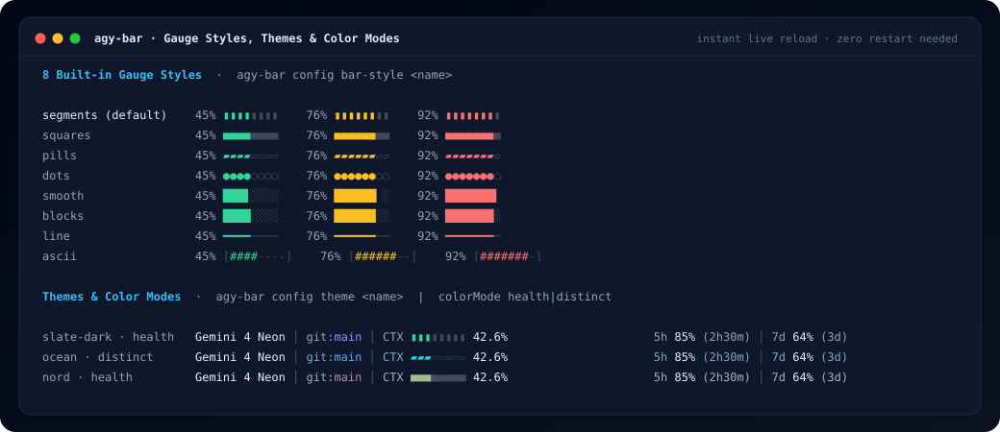
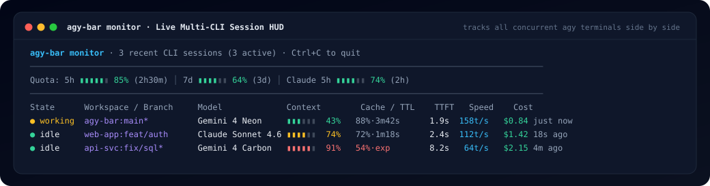
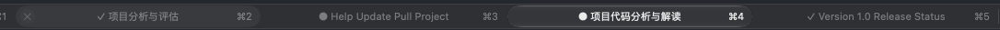

<div align="center">

# agy-bar

**Zero-dependency statusline, no-TUN proxy launcher, 52-week token heatmap & multi-CLI HUD for Antigravity CLI (`agy`)**

**English** | [简体中文](./README.zh-CN.md)

[](https://github.com/xy-tuoren/agy-bar/actions/workflows/ci.yml)
[](https://www.npmjs.com/package/agy-bar)
[](https://nodejs.org/)
[](#)
[](./LICENSE)

</div>


<sub>Real Ghostty capture: 10 running subagents (`⚡10`), live Git diff (`+14.3K -803`), no-TUN proxy (`PX 7897`), 1.01B cumulative tokens, 99% prompt cache TTL, TTFT & speed, live conversation spend, and 5h/7d quotas.</sub>


```sh
# Install in one command (Node.js >= 20, zero dependencies)
npx agy-bar install
```

---

## At a Glance — Two-Line Anatomy

`agy-bar` keeps idle terminals calm and high-signal, separating **workspace identity & cumulative overview (Line 1)** from **live session metrics & account quotas (Line 2)**:

```text
~/code/agy-bar (main* +142 -38) · PX 7897     DAY 136M/$13.2 · WK 810M · MO 875M · ALL 906M │ Gemini 4 Neon · xhigh
CTX ▮▮▮▯▯▯▯▯ 42.6% (1.0M) │ CACHE 88%·3m42s │ TTFT 1.9s·158t/s │ ~$0.18   5h ▮▮▮▮▮▯ 85% (2h30m) │ 7d ▮▮▮▮▯▯ 64% (3d)
```

| Zone | What It Shows | Smart Behavior |
| --- | --- | --- |
| **Line 1 · Left** | `~/code/agy-bar (main* +142 -38) · PX 7897` | Compact `~` path (`dirStyle`), live Git diff lines (tracked + untracked text, 3s cache), active proxy port badge, plus on-demand state badges (`CONFIRM` / `INPUT` when waiting on you, `ERR`, `● 34s · esc`, `SUB N` subagents, `TASK N` background tasks, `PLAN` / `SANDBOX`, Vim `[NORMAL]`) |
| **Line 1 · Right** | `DAY 136M/$13.2 · WK 810M · MO 875M · ALL 906M │ Model` | Calm neutral cumulative token/spend strip + active model & reasoning effort; sheds gracefully on narrow split panes |
| **Line 2 · Left** | `CTX ▮▮▮▯▯▯▯▯ 42.6% (1.0M) │ CACHE 88%·3m42s │ TTFT 1.9s·158t/s │ ~$0.18` | Unified health context gauge (`→/compact` at danger), 5-min prompt cache TTL countdown, exact first-token latency + streaming decode speed, and live conversation spend (rolls up nested subagent costs automatically, refreshing every 20s while subagents run) |
| **Line 2 · Right** | `5h ▮▮▮▮▮▯ 85% (2h30m) │ 7d ▮▮▮▮▯▯ 64% (3d)` | Active model pool quotas (**Gemini 4 Neon / Carbon / Hydrogen / Argon** & **Claude 3p**) with reset countdowns |

---

## Feature Showcase

### 1. Crisp Segmented Gauges, 8 Bar Styles & 6 Themes

Choose from **8 gauge styles** (`segments` default `▮▮▮▯▯▯`, `squares`, `pills`, `dots`, `smooth`, `blocks`, `line`, `ascii`), **6 themes** (`auto`, `slate-dark`, `slate-light`, `ocean`, `nord`, `mono`), and **2 color modes** (`health` unified green→amber→red, or `distinct` cyan CTX vs green quota). Every preference takes effect on the next refresh with zero restart.



---

### 2. Full-History Token Dashboard & 52-Week Heatmap (`agy-bar stats`)

Incrementally scans local Antigravity CLI & Desktop conversation DBs in **read-only mode** (never reads prompt/reply text; `< 20ms` cached) to render an 80-col-safe 4-card overview (`All-Time / Today / Month / Year`), a **52-week terminal activity heatmap** (`purple` / `green` / `cyan` / `amber`, auto-adapted for dark & light themes), active streaks, CLI vs Desktop breakdown, per-model TTFT/speed table, and **estimated API cost + cache savings**.


---

### 3. Multi-CLI Live Monitor (`agy-bar monitor`)

Running 3–5 `agy` sessions across different repos? Open `agy-bar monitor` in a side pane to watch every active terminal live — working/idle status, workspace & branch, model, context bar, 5-min cache TTL, TTFT, decode speed, session spend, and global quotas.



---

### 4. No-TUN Local Proxy Launcher & Live Pricing Cache (`agy-bar proxy` & `agy-bar pricing`)

- **No-TUN Proxy (`agy` / `agy-bar run` / `agy-bar proxy`)**: Auto-detects macOS/Windows system proxies or local Clash Verge / Clash / Surge / v2ray ports (`7897`, `7890`, `6152`, `10809`, `1087`, ...) and injects standard `HTTP_PROXY`/`HTTPS_PROXY`/`ALL_PROXY` + loopback-safe `NO_PROXY` without enabling TUN mode or patching binaries. Opt into the reversible 7-line `agy()` shell hook during `install` (or anytime via `agy-bar proxy hook`) to just type plain `agy`.
- **3-Tier Dynamic Pricing (`agy-bar pricing`)**: Resolves rates in `< 0.1ms` (`custom override` → `24h background SWR cache from models.dev / LiteLLM` → `built-in calibrated rates`). Proxy-aware, ETag `304`, zero auth, disable anytime with `agy-bar config set pricingAutoSync off`.


---

### 5. Automatic Terminal Tab Titles (`●` / `● [N]` / `?` / `✓`) & Agent Summarization (`agy-bar title`)

Replaces identical `agy --dangerously-skip-permissions` tabs across Ghostty, iTerm2, Kitty, WezTerm, macOS Terminal, and VS Code with live activity state (`●` working, `● [N]` running subagents, `?` waiting for user input/confirmation, `✗` error, `✓` truly idle) + concise topic title via standard OSC 0/2 (zero extra tokens; safely skipped on native Windows):



<sub>Real Ghostty tab bar: auto-synced tabs (`● agy-bar 开源状态栏`, `📊 agy-bar Token 热力图`) right next to an unmodified default `agy --dangerously-skip-per...` tab.</sub>

> **Pro Tip — Auto-summarize tab titles on topic shifts (~10 tokens, zero extra API calls)**
> Add this one line to your global `~/.gemini/antigravity-cli/AGENTS.md`:
> ```text
> When the user starts a clearly new task/topic in a long session, silently run `agy-bar title "<4-8 word concise topic>"` once to keep the terminal tab title up to date.
> ```

---

## Why `agy-bar`? (Safety, Privacy & Performance)

| Guarantee | How It Works |
| --- | --- |
| **100% Official `statusLine` Hook** | Zero binary patching, zero Electron injection, zero Google/AGY private API calls, zero account credential access. Survives every AGY update cleanly. |
| **Read-Only Local Telemetry** | SQLite conversation scans (`Node >= 22.13`) open DBs in `readOnly: true` mode and extract **only numeric timestamps & token counts** — never prompts or replies. |
| **Transparent Network Policy** | Statusline rendering itself **never touches the network**. Only an optional 24-hour background sync fetches public unauthenticated pricing JSON (`models.dev` / `LiteLLM`); run `agy-bar config set pricingAutoSync off` for strict offline mode. |
| **Zero-Dep Fast Hot Path** | `0` runtime dependencies, zero-subprocess idle refreshes (PID fast-path + 3s Git cache + SQLite `mtime` skip + 5-min Windows theme cache), and atomic file writes across concurrent terminals. |

---

## Quick Start

Requires **Node.js >= 20.0.0** and **Antigravity CLI (`agy`)**.

### Option 1: Via `npx` (Fastest)

```sh
npx agy-bar install
```

### Option 2: Let `agy` install it for you

Paste this into an `agy` chat:

```text
Please follow https://github.com/xy-tuoren/agy-bar/blob/main/AGENTS.md to install agy-bar for me.
```

### Option 3: Manual install (GitHub)

```sh
git clone https://github.com/xy-tuoren/agy-bar.git ~/agy-bar
cd ~/agy-bar
node bin/agy-bar.mjs install
```

Then **restart `agy`** to activate the statusline (in an existing session, run `/skills reload` to load `/agy-bar`). `install` also places the global `agy-bar` command at `~/.local/bin/agy-bar` and safely backs up your previous `statusLine`. Pass `--no-skill` to skip installing the companion `/agy-bar` skill.

---

## Common Commands

```sh
# No-TUN proxy launcher
agy-bar proxy status            # Inspect effective proxy, shell hook & live latency
agy-bar proxy hook              # Opt in so plain `agy` auto-uses local proxy (removable via `unhook`)
agy-bar run -c                  # Launch `agy -c` through local proxy without modifying ~/.zshrc
agy-bar proxy set 127.0.0.1:7897

# Stats, pricing, monitor, tab title & debug
agy-bar stats [today|7d|30d|all] [--palette purple|green|cyan|amber] [--source all|cli|desktop|ledger]
agy-bar pricing show | sync | set <model> <in> <out> [cacheRead] | reset
agy-bar monitor [--once]
agy-bar title "short topic"     # Or: agy-bar title --clear
agy-bar debug --capture         # Capture a PII-redacted AGY payload snapshot
agy-bar preview --scenario all
agy-bar doctor
```

<details>
<summary><strong>Full Configuration Reference (presets, themes, bar styles, toggles & thresholds)</strong></summary>

Changes apply immediately on the next statusline refresh — no restart needed:

```sh
# Layout presets: dashboard | compact | minimal
agy-bar config preset compact

# Themes: auto | slate-dark | slate-light | ocean | nord | mono
agy-bar config theme ocean

# Gauge styles: segments (default) | squares | pills | dots | smooth | blocks | line | ascii
agy-bar config bar-style squares

# Workspace path style: short (~/code/agy-bar, default) | parent (code/agy-bar) | name (agy-bar)
agy-bar config set dirStyle short

# Color mode: health (unified green->amber->red) | distinct (blue CTX vs green quota)
agy-bar config set colorMode health

# Toggle individual items:
#   hint, vim, mode, subagents, turnTimer, proxy, dir, model, effort, git, gitDirty, gitDiff,
#   context, contextBar, contextDelta, compactHint, capacity, cache, cacheTtl, ttft, speed,
#   cost, todayCost, session, todayTokens, weekTokens, monthTokens, totalTokens,
#   quota, quotaBar, quota5h, quotaWeekly, reset
agy-bar config enable session contextDelta
agy-bar config disable turnTimer gitDiff

# Per-model thresholds, cache TTL, timing & offline mode
agy-bar config set modelThreshold.claude.warn 65 modelThreshold.claude.danger 85
agy-bar config set cacheTtlSec 300 dbTiming on pricingAutoSync off

# Inspect or reset all preferences
agy-bar config show
agy-bar config reset
```

</details>

---

## Terminal & OS Compatibility

- **Truecolor & 256-Color Auto-Adaptation**: Emits 24-bit Truecolor in Ghostty, iTerm2, Kitty, WezTerm, Alacritty, Warp, VS Code, and Windows Terminal; automatically downscales to nearest xterm-256 colors in macOS `Terminal.app` (`Apple_Terminal`) and `tmux` / `screen` / SSH without `COLORTERM=truecolor`; honors `NO_COLOR` and `TERM=dumb`.
- **Light & Dark Themes**: Automatically adapts both statusline palettes and `agy-bar stats` heatmap ramps for light and dark backgrounds.
- **Windows Notes**: Supported on Windows Terminal, PowerShell 7 (`pwsh`), Windows PowerShell 5.1, and `cmd.exe` (including `.cmd` shims, Windows system proxy detection, and 5-min cached dark/light theme detection). Automatic OSC tab title sync is macOS/Linux/WSL only and is safely skipped on native Windows. On older ConHost fonts missing `▮`, switch with `agy-bar config bar-style squares` or `blocks`.

---

## Update & Uninstall

```sh
# Update (preserves config, ledger, pricing cache & original statusLine backup)
npx agy-bar@latest install

# Uninstall & restore previous statusLine + remove managed shell hook cleanly
npx agy-bar uninstall            # or: agy-bar uninstall

# Complete cleanup including current terminal's proxy env vars & agy() function (zsh/bash):
eval "$(agy-bar uninstall --remove-skill --purge --print-cleanup)"
# (fish: agy-bar uninstall --remove-skill --purge --print-cleanup --fish | source)
# (pwsh: agy-bar uninstall --remove-skill --purge --print-cleanup --pwsh | Invoke-Expression)
```

## Development

```sh
npm test            # Cross-platform Node.js built-in test suite (75 tests)
npm run preview     # Render live terminal preview
npm run preview:svg # Regenerate all 5 showcase SVGs in assets/
npm run stats       # Show local usage stats
npm run pricing     # Inspect or sync model pricing cache
npm run monitor     # Launch multi-CLI HUD
npm run doctor      # Verify local installation
```

## License

[MIT](./LICENSE) © [xy-tuoren](https://github.com/xy-tuoren)
