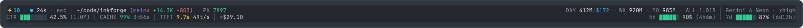
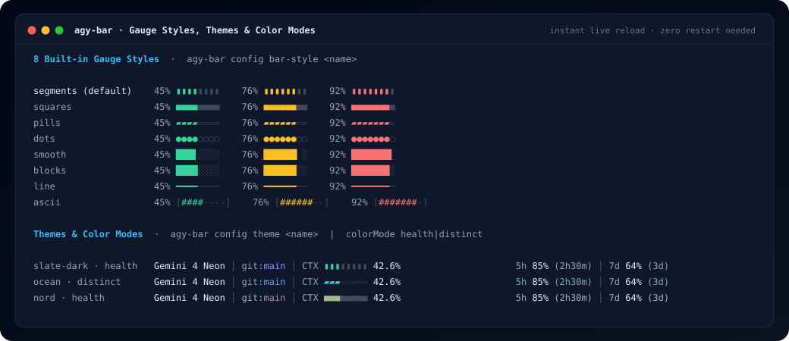
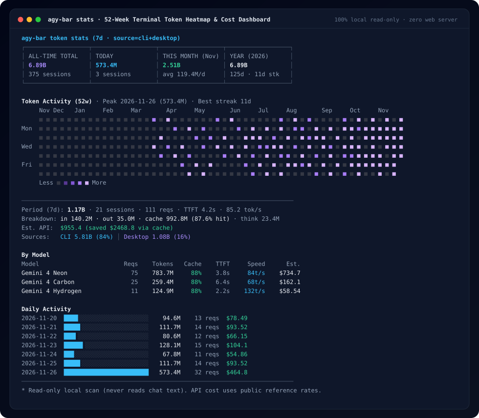
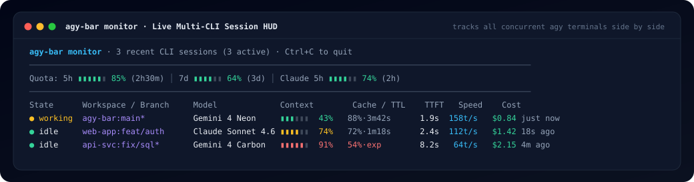
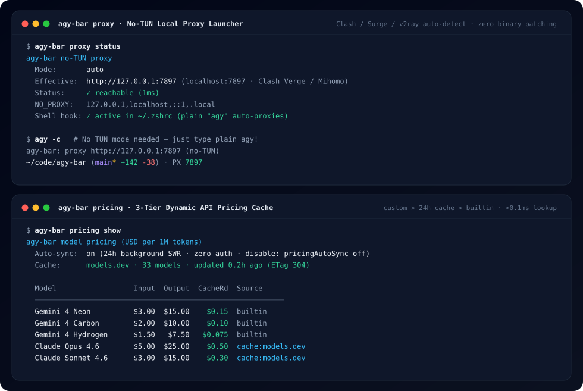
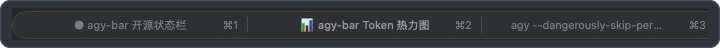

<div align="center">

# agy-bar

**专为 Antigravity CLI (`agy`) 打造的零依赖终端状态栏、免 TUN 代理启动器、52 周 Token 热力图与多 CLI 监视面板**

[English](./README.md) | **简体中文**

[](https://github.com/xy-tuoren/agy-bar/actions/workflows/ci.yml)
[](https://www.npmjs.com/package/agy-bar)
[](https://nodejs.org/)
[](#)
[](./LICENSE)

</div>



<sub>Ghostty 真机实拍：10 并发子代理（`⚡10`）、实时代码增删（`+14.3K -803`）、免 TUN 本地代理（`PX 7897`）、1.01B 累计 Token、99% 缓存倒计时、TTFT/速率、本对话预估费用与 5h/7d 额度条。</sub>


```sh
# 一行命令安装（需 Node.js >= 20，零第三方依赖）
npx agy-bar install
```

---

## 一图看懂两行状态栏布局

`agy-bar` 在空闲时保持极简克制，将 **第一行「工作区身份与累计总览」** 与 **第二行「当前对话指标与账号额度」** 清晰分离：

```text
~/code/agy-bar (main* +142 -38) · PX 7897     DAY 136M/$13.2 · WK 810M · MO 875M · ALL 906M │ Gemini 4 Neon · xhigh
CTX ▮▮▮▯▯▯▯▯ 42.6% (1.0M) │ CACHE 88%·3m42s │ TTFT 1.9s·158t/s │ ~$0.18   5h ▮▮▮▮▮▯ 85% (2h30m) │ 7d ▮▮▮▮▯▯ 64% (3d)
```

| 区域 | 显示内容 | 贴心细节 |
| --- | --- | --- |
| **第一行 · 左侧** | `~/code/agy-bar (main* +142 -38) · PX 7897` | 精简 `~` 路径（`dirStyle`）、当前改动实时增删行数（含已追踪修改与新建文本文件，3s 缓存）、本地代理端口徽章；仅在工作态按需亮起 `● 34s · esc`、并行子代理 `⚡2`、`PLAN`/`SANDBOX`、Vim `[NORMAL]` |
| **第一行 · 右侧** | `DAY 136M/$13.2 · WK 810M · MO 875M · ALL 906M │ 模型` | 低饱和中性配色汇总今日/本周/本月/累计用量与今日费用 + 当前模型与思考强度；窄分屏自动分级退让 |
| **第二行 · 左侧** | `CTX ▮▮▮▯▯▯▯▯ 42.6% (1.0M) │ CACHE 88%·3m42s │ TTFT 1.9s·158t/s │ ~$0.18` | 统一健康色上下文条（危急提示 `→/compact`）、5 分钟缓存保活倒计时、首字时间 + 纯解码速率、本对话预估费用（自动归集所有子代理与嵌套孙代理开销，子代理运行中每 20 秒准实时刷新） |
| **第二行 · 右侧** | `5h ▮▮▮▮▮▯ 85% (2h30m) │ 7d ▮▮▮▮▯▯ 64% (3d)` | 自动匹配当前模型额度池（**Gemini 4 Neon / Carbon / Hydrogen / Argon** 与 **Claude 3p**）及重置倒计时 |

---

## 核心功能展示

### 1. 清爽分格进度条、8 种样式与 6 套主题

内置 **8 种进度条风格**（默认 `segments` `▮▮▮▯▯▯` 在 Ghostty 等 GPU 终端下依然格界分明，另含 `squares` / `pills` / `dots` / `smooth` / `blocks` / `line` / `ascii`）、**6 套主题**（`auto` / `slate-dark` / `slate-light` / `ocean` / `nord` / `mono`）与 **2 种配色模式**（`health` 统一健康色 / `distinct` 双色区分），改完下次刷新立即生效，无需重启 `agy`。



---

### 2. 全量历史 Token 面板与 52 周热力图 (`agy-bar stats`)

只读增量扫描本机 Antigravity CLI 与桌面端全部历史会话库（**不读任何聊天正文**，带增量缓存二次运行 `< 20ms`），直接在终端内渲染适配 80 列宽度的 **全量 / 今日 / 本月 / 年度 4 项总览卡片**、**52 周活动热力图**（`purple` / `green` / `cyan` / `amber` 四套渐变，自动适配深浅主题）、连续活跃天数、CLI 与桌面端占比、各模型 TTFT/速率排行、以及 **参考 API 费用与缓存省钱金额**。



---

### 3. 多 CLI 协作实时监视面板 (`agy-bar monitor`)

同时开了三五个 `agy` 终端跨项目协作？在侧边分屏运行 `agy-bar monitor`，一屏掌握所有活跃会话的工作/空闲状态、项目与分支、模型、上下文进度、5 分钟缓存剩余时间、TTFT、吐字速率、单会话费用及全局额度。



---

### 4. 免 TUN 本地代理启动器 & 动态参考定价缓存 (`agy-bar proxy` & `agy-bar pricing`)

- **免 TUN 代理（`agy` / `agy-bar run` / `agy-bar proxy`）**：自动检测 macOS/Windows 系统代理或本机 Clash Verge / Clash / Surge / v2ray 监听端口（`7897`、`7890`、`6152`、`10809`、`1087` 等），为 `agy` 注入标准 `HTTP_PROXY`/`HTTPS_PROXY`/`ALL_PROXY` 与回环安全的 `NO_PROXY`，无需开启全局 TUN、零二进制侵入。在安装时（或随时运行 `agy-bar proxy hook`）启用可无损卸载的 7 行 `agy()` Shell Hook 后，直接敲 `agy` 即可自动走代理。
- **三级动态定价缓存（`agy-bar pricing`）**：`< 0.1ms` 本地查表（`用户自定义单价` → `24h 后台 SWR 同步的 models.dev / LiteLLM 缓存` → `内置校准价`）。自动复用代理、支持 `ETag 304`、零鉴权，随时可 `agy-bar config set pricingAutoSync off` 彻底离线。



---

### 5. 终端标签页标题自动同步 (`●` / `✓`) 与 Agent 摘要 (`agy-bar title`)

彻底告别多开时所有标签页都叫 `agy --dangerously-skip-permissions` 的烦恼：在 macOS / Linux / WSL 下的 Ghostty、iTerm2、Kitty、WezTerm、Terminal.app、VS Code 中通过标准 OSC 0/2 自动同步工作状态与精简主题（零额外 Token；原生 Windows 自动安全跳过）：



<sub>Ghostty 标签栏真机对比：左侧已自动同步为 `● agy-bar 开源状态栏`、`📊 agy-bar Token 热力图`，右侧为未启用前的默认 `agy --dangerously-skip-per...`。</sub>

> **进阶技巧 — 让 Agent 换话题时自动缩写标签名（仅耗 ~10 tokens，零额外 API 调用）**
> 在你的全局 `~/.gemini/antigravity-cli/AGENTS.md` 里加上这一句即可：
> ```text
> 当用户在长对话中明显切换到新任务或新话题时，静默执行一次 `agy-bar title "<4~8字中文简短主题>"` 更新终端标签页标题。
> ```

---

## 为什么选 `agy-bar`？（安全、隐私与性能保证）

| 承诺 | 实现机制 |
| --- | --- |
| **100% 官方原生 `statusLine` 接口** | 不修改/不注入任何客户端二进制，不调用任何 Google/AGY 私有接口，不接触账号凭据；官方任意升级不失效、零封号风险。 |
| **只读本地数值遥测** | SQLite 历史扫描（`Node >= 22.13`）全程 `readOnly: true`，**仅提取数值时间戳与 Token 计数**，绝不读取聊天正文。 |
| **透明联网策略** | 底栏渲染热路径**完全不联网**；仅默认每 24 小时后台异步拉取一次公开免鉴权的 `models.dev` / `LiteLLM` 参考单价，随时可 `agy-bar config set pricingAutoSync off` 严格离线。 |
| **零依赖极致流畅** | `0` 第三方依赖，空闲刷新零子进程（PID 快速路径 + 3s Git 缓存 + SQLite `mtime` 跳过 + 5 分钟 Windows 主题缓存），多终端并发采用原子写防文件损坏。 |

---

## 快速安装

环境要求：**Node.js >= 20.0.0** 与 **Antigravity CLI (`agy`)**。

### 方式一：通过 `npx` 一键安装（推荐）

```sh
npx agy-bar install
```

### 方式二：让 `agy` 自动帮你装

直接在 `agy` 对话中发送这一句：

```text
请按 https://github.com/xy-tuoren/agy-bar/blob/main/AGENTS.md 帮我安装 agy-bar。
```

### 方式三：手动从 GitHub 安装

```sh
git clone https://github.com/xy-tuoren/agy-bar.git ~/agy-bar
cd ~/agy-bar
node bin/agy-bar.mjs install
```

安装完成后**重启 `agy`** 即可生效（已有会话可先运行 `/skills reload` 加载 `/agy-bar`）。`install` 会自动安装全局命令 `~/.local/bin/agy-bar` 并备份原有 `statusLine` 配置；若不需要配套 `/agy-bar` Skill，可加 `--no-skill`。

---

## 常用命令

```sh
# 免 TUN 本地代理启动器
agy-bar proxy status            # 查看有效代理、Shell Hook 状态与实时连通延迟
agy-bar proxy hook              # 启用直接敲 `agy` 自动走代理（随时可 `unhook` 移除）
agy-bar run -c                  # 不改 ~/.zshrc 直接通过代理启动 `agy -c`
agy-bar proxy set 127.0.0.1:7897

# 统计、定价、监视面板、标签标题与抓包调试
agy-bar stats [today|7d|30d|all] [--palette purple|green|cyan|amber] [--source all|cli|desktop|ledger]
agy-bar pricing show | sync | set <model> <in> <out> [cacheRead] | reset
agy-bar monitor [--once]
agy-bar title "简短主题"         # 或：agy-bar title --clear
agy-bar debug --capture         # 单次自动脱敏捕获真实 AGY payload
agy-bar preview --scenario all
agy-bar doctor
```

<details>
<summary><strong>完整个性化配置参考（预设、主题、进度条、单项开关与阈值）</strong></summary>

所有配置修改后下次刷新即生效，无需重启 `agy`：

```sh
# 布局预设：dashboard | compact | minimal
agy-bar config preset compact

# 主题：auto | slate-dark | slate-light | ocean | nord | mono
agy-bar config theme ocean

# 进度条风格：segments（默认）| squares | pills | dots | smooth | blocks | line | ascii
agy-bar config bar-style squares

# 工作区路径风格：short（~/code/agy-bar 默认）| parent（code/agy-bar）| name（agy-bar）
agy-bar config set dirStyle short

# 配色模式：health（左右统一健康绿→黄→红）| distinct（左侧蓝 / 右侧绿）
agy-bar config set colorMode health

# 自由开关单项：
#   hint, vim, mode, subagents, turnTimer, proxy, dir, model, effort, git, gitDirty, gitDiff,
#   context, contextBar, contextDelta, compactHint, capacity, cache, cacheTtl, ttft, speed,
#   cost, todayCost, session, todayTokens, weekTokens, monthTokens, totalTokens,
#   quota, quotaBar, quota5h, quotaWeekly, reset
agy-bar config enable session contextDelta
agy-bar config disable turnTimer gitDiff

# 按模型设告警红线、缓存倒计时、数据库精确计时与离线开关
agy-bar config set modelThreshold.claude.warn 65 modelThreshold.claude.danger 85
agy-bar config set cacheTtlSec 300 dbTiming on pricingAutoSync off

# 查看或重置全部配置
agy-bar config show
agy-bar config reset
```

</details>

---

## 终端与系统兼容性

- **真彩与 256 色终端自动适配**：在 Ghostty、iTerm2、Kitty、WezTerm、Alacritty、Warp、VS Code、Windows Terminal 中输出 24-bit 真彩；在 macOS 自带 `Terminal.app`（`Apple_Terminal`）及未开真彩的 `tmux` / `screen` / SSH 下自动降级为最接近的 xterm-256 色；完整遵守 `NO_COLOR` 与 `TERM=dumb`。
- **深浅主题自适应**：状态栏配色与 `agy-bar stats` 52 周热力图均自动适配深色与浅色背景。
- **Windows 说明**：支持 Windows Terminal、PowerShell 7（`pwsh`）、Windows PowerShell 5.1 与 `cmd.exe`（兼容 `.cmd` 入口、Windows 系统代理检测、主题注册表 5 分钟缓存）。OSC 标签页标题同步仅适用于 macOS / Linux / WSL，原生 Windows 会自动安全跳过；如老版 ConHost 字体缺少 `▮`，可执行 `agy-bar config bar-style squares` 或 `blocks`。

---

## 更新与卸载

```sh
# 更新（保留个人配置、历史账本、定价缓存与原始 statusLine 备份）
npx agy-bar@latest install

# 卸载并无损恢复原有 statusLine、移除托管 Shell Hook
npx agy-bar uninstall            # 或：agy-bar uninstall

# 彻底清理（含 Skill、配置目录，并立即清掉当前终端内存中的 agy() 函数与代理环境变量）
eval "$(agy-bar uninstall --remove-skill --purge --print-cleanup)"
# (fish: agy-bar uninstall --remove-skill --purge --print-cleanup --fish | source)
# (PowerShell: agy-bar uninstall --remove-skill --purge --print-cleanup --pwsh | Invoke-Expression)
```

## 本地开发

```sh
npm test            # 运行内置单元测试（75 项，macOS / Linux / Windows 三端 CI 验证）
npm run preview     # 终端实时预览
npm run preview:svg # 重新生成 assets/ 下全部 5 张展示 SVG
npm run stats       # 查看本机统计
npm run pricing     # 查看或同步模型参考定价缓存
npm run monitor     # 启动多 CLI 监控面板
npm run doctor      # 检查本机安装状态
```

## 开源协议

[MIT](./LICENSE) © [xy-tuoren](https://github.com/xy-tuoren)
