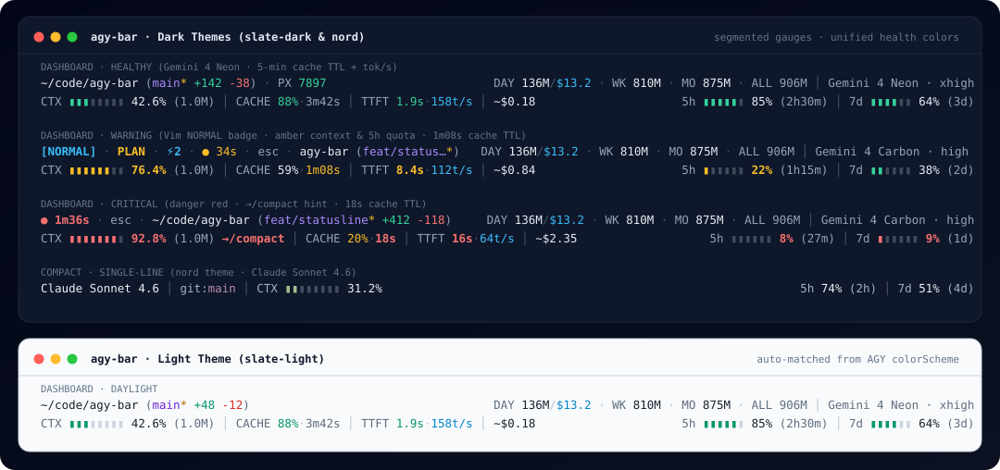

<div align="center">

# agy-bar

**专为 Antigravity CLI (`agy`) 打造的零依赖终端状态栏、原生 6 态标签页标题、免 TUN 本地代理启动器、52 周 Token 热力图与多 CLI 监视面板**

[English](./README.md) | **简体中文** | [AI Agent 自动安装指南 (`AGENTS.md`)](./AGENTS.md) | [机器可读索引 (`llms.txt`)](./llms.txt) | [LINUX DO](https://linux.do)

[](https://github.com/xy-tuoren/agy-bar/actions/workflows/ci.yml)
[](https://www.npmjs.com/package/agy-bar)
[](https://www.npmjs.com/package/agy-bar)
[](https://nodejs.org/)
[](#)
[](./LICENSE)

</div>



```sh
# 一行命令安装（需 Node.js >= 20，零第三方依赖，支持 macOS / Linux / Windows）
npx -y agy-bar@latest install
```

> **直接让 AI Agent 帮你安装**——把下面这句发给 `agy` / Claude Code / Codex 即可：
> ```text
> 请按 https://raw.githubusercontent.com/xy-tuoren/agy-bar/main/AGENTS.md 帮我安装 agy-bar。
> ```

---

## 为什么选择 `agy-bar`？（核心优势对比）

Antigravity CLI (`agy`) 原生底栏信息有限、多开终端标签页全撞名，且直连代理常需打开全局 TUN。**`agy-bar`** 100% 基于官方 `settings.json` 钩子打造，在不修改任何二进制、不引入第三方依赖的前提下，一次性补齐工程级可观测性与效率体验：

| 默认 `agy` 的痛点 | 装上 `agy-bar` 之后 |
| --- | --- |
| **看不到上下文健康度、缓存失效、首字耗时与费用** | 分格 `CTX` 进度条（危急提示 `→/compact`）、**5 分钟 Prompt 缓存倒计时**、数据库级精确 **TTFT 首字延迟 + 纯解码 `tok/s`**、本会话实时预估费用（自动归集嵌套子代理）与 `DAY / WK / MO / ALL` 总量。 |
| **多终端额度不同步，5h 到点卡在 `0%`** | 自动匹配 **Gemini 4（Neon / Carbon / Hydrogen / Argon）** 与 **Claude 3p** 的 `5h` / `7d` 额度池，多终端本地自动同步最新快照，5h 到点且 `7d` 有余量时显示绿色 `(ready)`。 |
| **多开标签页全叫 `agy --dangerously-skip-per...`** | 接入官方原生 `title` 接口（兼容 macOS / Linux / Windows Terminal），实时显示 **6 种状态前缀**（`●` / `● [N]` / `?` / `✗` / `…` / `✓`）+ 自动同步首轮概括标题（含全新对话）+ 可选低 Token 随话题自动改名。 |
| **为了代理被迫开全局 TUN 模式** | 内置**免 TUN 代理启动器**（`agy-bar run` 或按需启用可无损卸载的 7 行 `agy()` Shell Hook），自动识别系统代理与本机 Clash / Clash Verge / Surge / v2ray 端口（`7897`、`7890`、`6152`、`10809` 等）并保护本地回环 `NO_PROXY`。 |
| **多窗口协作与历史用量无从总览** | 侧边分屏 **`agy-bar monitor`** 一屏监控所有活跃 CLI；**`agy-bar stats`** 秒级（缓存 `< 20ms`）生成 **52 周终端 Token 热力图**、连续活跃天数、CLI 与桌面端占比及缓存省钱统计。 |
| **担心魔改封号、依赖臃肿或隐私泄露** | **`0` 第三方依赖**、零二进制篡改、零私有 API 调用、空闲刷新零子进程、`readOnly: true` 只读本地元数据（**绝不读聊天正文**），一条命令 `pricingAutoSync off` 即可彻底离线。 |

---

## 全标签、配色阈值与状态符号图鉴

`agy-bar` 在空闲时保持极简克制，将 **第一行「工作区身份、按需状态徽章与累计总览」** 与 **第二行「当前会话指标与账号额度」** 清晰分离：

```text
~/code/agy-bar (main* +142 -38) · PX 7897     DAY 136M/$13.2 · WK 810M · MO 875M · ALL 906M │ Gemini 4 Neon · xhigh
CTX ▮▮▮▯▯▯▯▯ 42.6% (1.0M) │ CACHE 88%·3m42s │ TTFT 1.9s·158t/s │ ~$0.18   5h ▮▮▮▮▮▯ 85% (2h30m) │ 7d ▮▮▮▮▯▯ 64% (3d)
```

### 第一行 · 常驻工作区、累计用量与模型

| 标签 / 示例 | 含义 | 智能行为与配色规则 | 开关项 (`show.*`) |
| --- | --- | --- | --- |
| `~/code/agy-bar` | 当前工作区路径 | 精简 `~` 路径（`dirStyle`: `short` \| `parent` \| `name`），窄分屏自动退让为项目目录名 | `dir` |
| `(main* +142 -38)` | Git 分支、脏状态 `*` 与实时代码增删行数 | 紫色分支名、黄色 `*`、绿 `+新增` / 红 `-删除`（覆盖已追踪修改与新建文本文件，3s 缓存，干净时隐藏） | `git`, `gitDirty`, `gitDiff` |
| `PX 7897` / `PX on` | 当前活跃代理端口徽章 | 直接从进程内存读取 `HTTPS_PROXY`/`HTTP_PROXY`/`ALL_PROXY`（`0ms`、绝不暴露账号密码），直连时隐藏 | `proxy` |
| `DAY 136M/$13.2` | 今日累计 Token 与估算 API 费用 | 中性白 Token + 青蓝色美元金额，覆盖 CLI + 桌面端历史并按轮实时累加 | `todayTokens`, `todayCost` |
| `WK 810M` / `MO 875M` / `ALL 906M` | 近 7 天、本月与历史累计总 Token | 低饱和中性色，窄终端自动分级退让（`MO` → `WK` → `ALL` → `DAY`） | `weekTokens`, `monthTokens`, `totalTokens` |
| `Gemini 4 Neon · xhigh` | 当前模型与思考强度 | 自动去除重复括号后缀 | `model`, `effort` |

### 第一行 · 按需亮起的状态与模式徽章 *(空闲时自动隐藏)*

| 徽章 / 示例 | 触发条件 | 配色与阈值 | 开关项 (`show.*`) |
| --- | --- | --- | --- |
| `[NORMAL]` / `[INSERT]` / `[VISUAL]` | `agy` 开启 Vim 编辑模式时 | 青蓝 `[NORMAL]`、绿 `[INSERT]`、紫 `[VISUAL]` | `vim` |
| `CONFIRM` | Agent 正在等待你确认工具调用（`tool_confirmation_pending: true`） | 粗体琥珀黄强提醒 | `mode` / `hint` |
| `INPUT` | Agent 暂停等待你的评审或输入（`agent_state: "reviewing"`） | 粗体琥珀黄强提醒 | `mode` / `hint` |
| `ERR` | 当前会话发生错误（`agent_state: "error"`） | 粗体红色告警 | `mode` / `hint` |
| `PLAN` / `SANDBOX` | 处于非默认执行模式（`cycle_mode: "plan"` / `sandbox.enabled`） | 粗体黄 `PLAN`、粗体紫 `SANDBOX` | `mode` |
| `SUB N` | 当前有 `N` 个并发子代理正在运行 | 灰 `SUB` + 粗体青蓝数字 `N` | `subagents` |
| `TASK N` | 当前有 `N` 个后台任务/开发服务运行中（`task_count > 0`） | 灰 `TASK` + 青蓝数字 `N` | `subagents` |
| `● 34s · esc` | 主 Agent 工作中（`working` / `tool_use` / `thinking`）+ 本轮耗时计时器 | 青蓝 `<30s` → 琥珀黄 `≥30s` → 粗体红 `≥90s`；右侧附 `esc` 取消提示 | `turnTimer`, `hint` |

### 第二行 · 实时会话指标、可选标签与账号额度

| 标签 / 示例 | 含义 | 配色规则与阈值 | 开关项 (`show.*`) |
| --- | --- | --- | --- |
| `CTX ▮▮▮▯▯▯▯▯ 42.6% (1.0M)` | 上下文占用率、8 格进度条与窗口总容量 | 默认统一 `health` 色：绿 `<70%` → 粗体黄 `≥70%` → 粗体红 `≥88%`（可按模型设 `modelThreshold.<model>.*`） | `context`, `contextBar`, `capacity` |
| `→/compact` | 上下文压缩行动提醒 | 粗体红，达到危险阈值（默认 `≥88%`）时紧贴 `CTX` 自动出现 | `compactHint` |
| `+12.4K` *(默认关闭)* | 上一轮对话上下文增量 | 中性灰，可通过 `agy-bar config enable contextDelta` 开启 | `contextDelta` |
| `CACHE 88%·3m42s` | Prompt 缓存命中率 + 5 分钟保活倒计时 | 命中率：绿 `≥70%` / 白 `30~69%` / 黄 `<30%`。倒计时：灰 `>90s` / 黄 `≤90s` / 粗体红 `≤30s` 或 `exp` | `cache`, `cacheTtl` |
| `TTFT 1.9s` | 精确首字延迟（优先读本机步骤时间戳，无库时自动回退 `stdin`） | 绿 `≤3s` → 白 `3~8s` → 粗体黄 `≥8s` → 粗体红 `≥15s`（可调 `ttftWarnSec` / `ttftDangerSec`） | `ttft` |
| `158t/s` | 纯流式解码速率（已剥离 TTFT 思考等待时间） | 青蓝 `≥60 t/s` → 白 `25~59 t/s` → 黄 `<25 t/s` | `speed` |
| `~$0.18` | 当前对话累计估算 API 费用 | 自动归集所有子代理与嵌套孙代理开销（子代理运行中每 20s 准实时刷新） | `cost` |
| `12m·8t` *(默认关闭)* | 当前会话持续时长与对话轮数 | 中性灰，可通过 `agy-bar config enable session` 开启 | `session` |
| `5h ▮▮▮▮▮▯ 85% (2h30m)` / `7d …` | 当前模型池 5 小时与 7 天剩余额度及重置倒计时 | 绿 `>25%` → 粗体黄 `≤25%` → 粗体红 `≤10%`（`quotaWarn` / `quotaDanger`）；多终端本地自动同步 | `quota`, `quotaBar`, `quota5h`, `quotaWeekly`, `reset` |
| `(ready)` vs `(due)` | 5h 重置到点提示 | 5h 已过重置时间且 `7d` 仍有余额时显示绿色 `(ready)`（发消息即刷新）；若受 `7d` 耗尽阻塞则保持红 `(due)` | `reset` |

### 终端标签页 · 6 态统一活动状态机（多开并行一眼决策）

| 标签页前缀 | 会话状态 | 触发条件 | 实战作用与价值（不用挨个切窗口盲查） | 对应底栏 / Monitor |
| --- | --- | --- | --- | --- |
| `● <主题>` | **工作中** | 主 Agent 运行中（`working` / `tool_use` / `thinking`） | 正在思考或写代码，放心留在别的窗口干活，无需反复切回干等 | `● 34s · esc` / `working` |
| `● [N] <主题>` | **子代理并行中** | 主 Agent 已暂停，但仍有 `N` 个子代理在跑 | 一眼看出后台还有 `N` 个子任务未收尾，**避免误以为完成而提前关闭或打断汇总** | `SUB N` / `sub:N` |
| `? <主题>` | **阻塞等你处理** | 工具审批待确认（`tool_confirmation_pending`）或 `reviewing` | 最高优先级提醒！Agent 卡在审批或等你拍板，**直达最该处理的标签页，零空等浪费** | `CONFIRM` / `INPUT` |
| `✗ <主题>` | **异常报错** | 会话出现错误（`agent_state: "error"`） | 任务报错中断立刻暴露，第一时间止损重试，不白等半天 | `ERR` / `error` |
| `… <主题>` | **启动 / 认证中** | 会话处于 `authenticating` 或 `initializing` | 刚拉起会话或待登录初始化，与“已完成”明确区分 | *(启动态)* / `auth`·`init` |
| `✓ <主题>` | **真正全部完成** | 主 Agent 与子代理均已空闲（后台 `TASK` 服务常驻仍保持 `✓`） | 明确告知任务已收工可以切回验收，**不被常驻 dev server 误报成忙碌** | *(安静/`TASK N`)* / `idle` |

> **标签页标题的 4 大优势（默认 `tabTitleSource: "auto"`）**：
> 1. **零 Token 自动首轮概括（含全新对话）**：依次解析 `customTitle` → AGY 实时 `conversation_title` → 只读兜底本机 `conversation_summaries.db` 的 `title` 列 → `项目名 (分支)`，连新开会话首轮也能自动切换成真实任务概括；
> 2. **100% 官方原生 `title` 钩子**：跨 macOS / Linux / 原生 Windows Terminal 稳定工作，零 `/dev/tty` 字符交错、零 `ps` 子进程；
> 3. **多标签 PID 精准定向**：多开并发调用 `agy-bar title` 时自动匹配宿主 `agy` PID，绝不误改隔壁标签；
> 4. **随话题演进且尊重 `/rename`**：配合 `~/.gemini/AGENTS.md` 一行规则即可在换话题时静默更新中文短标题，且手动 `/rename` 后自动让位。

---

## 核心功能展示

### 1. Ghostty 终端高负载真机实拍


<sub>Ghostty 真机高负载实拍：10 并发子代理（<code>v1.0+</code> 已统一显示为 <code>SUB 10</code>）、实时代码增删（<code>+14.3K -803</code>）、免 TUN 本地代理（<code>PX 7897</code>）、1.01B 累计 Token、99% 缓存倒计时、TTFT/速率、本对话预估费用与 5h/7d 额度条。</sub>

### 2. 8 种分格进度条、6 套主题与 2 种配色模式

内置 **8 种进度条风格**（默认 `segments` `▮▮▮▯▯▯` 在 Ghostty 等 GPU 终端下依然格界分明，另含 `squares` / `pills` / `dots` / `smooth` / `blocks` / `line` / `ascii`）、**6 套主题**（`auto` / `slate-dark` / `slate-light` / `ocean` / `nord` / `mono`）与 **2 种配色模式**（`health` 统一健康色 / `distinct` 双色区分），改完下次刷新立即生效，无需重启 `agy`。


### 3. 全量历史 Token 面板与 52 周热力图 (`agy-bar stats`)

只读增量扫描本机 Antigravity CLI 与桌面端全部历史会话库（**不读任何聊天正文**，带增量缓存二次运行 `< 20ms`），直接在终端内渲染适配 80 列宽度的 **全量 / 今日 / 本月 / 年度 4 项总览卡片**、**52 周活动热力图**（`purple` / `green` / `cyan` / `amber` 四套渐变，自动适配深浅主题）、连续活跃天数、CLI 与桌面端占比、各模型 TTFT/速率排行、以及 **参考 API 费用与缓存省钱金额**。


### 4. 多 CLI 协作实时监视面板 (`agy-bar monitor`)

同时开了三五个 `agy` 终端跨项目协作？在侧边分屏运行 `agy-bar monitor`，一屏掌握所有活跃会话的 6 态工作状态（`working` / `sub:3` / `? confirm` / `idle`）、项目与分支、模型、上下文进度、5 分钟缓存剩余时间、TTFT、吐字速率、单会话费用及全局额度。


### 5. 免 TUN 本地代理启动器 & 三级动态定价缓存 (`agy-bar proxy` & `agy-bar pricing`)

- **免 TUN 代理（`agy` / `agy-bar run` / `agy-bar proxy`）**：自动检测 macOS/Windows 系统代理或本机 Clash Verge / Clash / Surge / v2ray 监听端口（`7897`、`7890`、`6152`、`10809`、`1087` 等），为 `agy` 注入标准 `HTTP_PROXY`/`HTTPS_PROXY`/`ALL_PROXY` 与回环安全的 `NO_PROXY`，无需开启全局 TUN、零二进制侵入。在安装时（或随时运行 `agy-bar proxy hook`）启用可无损卸载的 7 行 `agy()` Shell Hook 后，直接敲 `agy` 即可自动走代理。
- **三级动态定价缓存（`agy-bar pricing`）**：`< 0.1ms` 本地查表（`用户自定义单价` → `24h 后台 SWR 同步的 models.dev / LiteLLM 缓存` → `内置校准价`）。自动复用代理、支持 `ETag 304`、零鉴权，随时可 `agy-bar config set pricingAutoSync off` 彻底离线。


### 6. 终端标签页标题自动同步与随话题动态更新 (`agy-bar title`)

接入 **Antigravity CLI 官方原生 `title` 接口**（`settings.json` → `title`，旧会话自动回退 OSC 0/2），在 Ghostty、iTerm2、Kitty、WezTerm、Terminal.app、VS Code 及原生 Windows Terminal 中稳定同步精确状态与精简主题：


> **进阶技巧 — 让 Agent 在换话题时自动同步中文简短标签（仅耗 ~10 tokens，零额外 API 调用）**
> 在 Antigravity 官方全局规则文件 **`~/.gemini/AGENTS.md`** 里加上这一句即可：
> ```markdown
> 在 Antigravity CLI (`agy`) 终端会话中，当用户发起明确的新任务或在长对话中切换到新话题时，静默执行一次 `agy-bar title "<4~8字中文简短主题>"` 更新终端标签页标题。
> ```
> *Ghostty 小贴士*：自定义标签名请优先使用 `agy-bar title "..."`，不要用 Ghostty 右键 **Change Title…**（会写入 `tabOverride` 锁死标签并屏蔽后续 `●` / `✓` 自动更新，清空留空回车即可解锁）。

---

## 安全、隐私与性能保证

| 承诺 | 实现机制 |
| --- | --- |
| **100% 官方原生 `statusLine` + `title` 接口** | 不修改/不注入任何客户端二进制，不调用任何 Google/AGY 私有接口，不接触账号凭据；官方任意升级不失效、零封号风险。 |
| **只读本地元数据遥测** | SQLite 扫描（`Node >= 22.13`）全程 `readOnly: true`，**仅提取数值时间戳、Token 计数、子代理父子 ID 与当前会话 `title` 元数据**，绝不读取聊天正文；随时可 `agy-bar config set dbTiming off` 完全关闭读库。 |
| **透明联网策略** | 底栏与标签标题渲染热路径**完全不联网**；仅默认每 24 小时后台异步拉取一次公开免鉴权的 `models.dev` / `LiteLLM` 参考单价，随时可 `agy-bar config set pricingAutoSync off` 严格离线。 |
| **零依赖极致流畅** | `0` 第三方依赖，空闲刷新零子进程（PID 快速路径 + 3s Git 缓存 + SQLite `.db`/`.db-wal` `mtime` 跳过 + 5 分钟 Windows 主题缓存），多终端并发采用原子写防文件损坏。 |

---

## 快速安装

环境要求：**Node.js >= 20.0.0** 与 **Antigravity CLI (`agy`)**。

### 方式一：通过 `npx` 一键安装（推荐）

```sh
npx -y agy-bar@latest install
```

### 方式二：让 AI Agent 自动帮你装

直接把下面这句发给 `agy`、Claude Code 或 Codex：

```text
请按 https://raw.githubusercontent.com/xy-tuoren/agy-bar/main/AGENTS.md 帮我安装 agy-bar。
```

### 方式三：手动从 GitHub 安装

```sh
git clone https://github.com/xy-tuoren/agy-bar.git ~/agy-bar
cd ~/agy-bar
node bin/agy-bar.mjs install
```

安装完成后**重启 `agy`** 即可激活状态栏与官方原生 `title` 接口（已有会话可先运行 `/skills reload` 加载 `/agy-bar`）。`install` 会自动安装全局命令 `~/.local/bin/agy-bar`、安全备份原有 `statusLine` / `title` 配置（不会覆盖用户已有的自定义 `title` 脚本），且默认不改动 `~/.zshrc`（按需启用代理 Hook）。如不需要配套 `/agy-bar` Skill 或原生 `title`，可加 `--no-skill` / `--no-title`。

---

## 常用命令

```sh
# 免 TUN 本地代理启动器
agy-bar proxy status            # 查看有效代理、Shell Hook 状态与实时连通延迟
agy-bar proxy hook              # 启用直接敲 `agy` 自动走代理（随时可 `unhook` 移除）
agy-bar run -c                  # 不改 ~/.zshrc 直接通过代理启动 `agy -c`
agy-bar proxy set 127.0.0.1:7897

# 多账号免浏览器无感切换 & CLI 额度管理（纯可选，三端支持 macOS / Linux / Windows，0 私有 API）
agy-bar account save work       # 收录当前已登录的 agy 账号至系统钥匙串（无头环境自动降级 0600 文件）
agy-bar account add alt1        # 保存当前号 → 调官方 `agy` 完成一次 OAuth 登录并自动收录新号
agy-bar account import          # 一键导入 Cockpit Tools（~/.cockpit_tools）现有账号或导出的 JSON 文件
agy-bar account ls [--json]     # 查看全部账号的 Gemini / Claude 5h/7d 额度条、READY/LOW/LIMITED 状态与解锁倒计时
agy-bar switch [alias|next]     # 免浏览器秒切账号（无参数弹出方向键选择器；`next` 自动挑选最充裕账号）
agy-bar switch next --family claude --handoff  # 自动切至最充裕的 Claude 账号并携深度上下文（任务工件 + git + 对话进展）启动新 `agy -i`
agy-bar config set autoSwitchOnLimit on autoHandoff on  # 可选：新开 `agy` 自动跳过限额号 + 限额敲 `/exit` 后原地自动切号续跑
agy-bar account backup vault.enc.json          # 导出 AES-256-GCM 加密备份（恢复：`agy-bar account restore`）

# 统计、定价、监视面板、标签标题与抓包调试
agy-bar stats [today|7d|30d|all] [--palette purple|green|cyan|amber] [--source all|cli|desktop|ledger] [--json]
agy-bar pricing show [--json] | sync | set <model> <in> <out> [cacheRead] | reset
agy-bar monitor [--once]
agy-bar title ["简短主题"]       # 查看当前标题、设置主题，或：agy-bar title --clear
agy-bar debug --capture         # 单次自动脱敏捕获真实 AGY payload
agy-bar preview --scenario all
agy-bar doctor
```

<details>
<summary><strong>完整个性化配置参考（预设、主题、进度条、单项开关与阈值）</strong></summary>

所有配置修改后下次刷新即生效，无需重启 `agy`：

```sh
# 布局预设：dashboard | compact | minimal
agy-bar config preset compact

# 主题：auto | slate-dark | slate-light | ocean | nord | mono
agy-bar config theme ocean

# 进度条风格：segments（默认）| squares | pills | dots | smooth | blocks | line | ascii
agy-bar config bar-style squares

# 工作区路径风格：short（~/code/agy-bar 默认）| parent（code/agy-bar）| name（agy-bar）
agy-bar config set dirStyle short

# 配色模式：health（左右统一健康绿→黄→红）| distinct（左侧蓝 / 右侧绿）
agy-bar config set colorMode health

# 标签页标题开关与来源：tabTitle on|off, tabTitleSource auto|title|dir|title+dir, tabTitleMaxLen 10..60
agy-bar config set tabTitle on tabTitleSource auto tabTitleMaxLen 26

# 自由开关单项：
#   hint, vim, mode, subagents, turnTimer, proxy, dir, model, effort, git, gitDirty, gitDiff,
#   context, contextBar, contextDelta, compactHint, capacity, cache, cacheTtl, ttft, speed,
#   cost, todayCost, session, todayTokens, weekTokens, monthTokens, totalTokens,
#   quota, quotaBar, quota5h, quotaWeekly, reset
agy-bar config enable session contextDelta
agy-bar config disable turnTimer gitDiff

# 按模型设告警红线、缓存倒计时、数据库精确计时与严格离线开关
agy-bar config set modelThreshold.claude.warn 65 modelThreshold.claude.danger 85
agy-bar config set cacheTtlSec 300 ttftWarnSec 8 ttftDangerSec 15 dbTiming on pricingAutoSync off

# 查看或重置全部配置
agy-bar config show
agy-bar config reset
```

</details>

---

## 面向 AI Agent 与自动化调用

以下为纯 Markdown 权威入口，便于各类 AI Agent 无噪音直拉解析：
- **结构化仓库索引**：[`llms.txt`](https://raw.githubusercontent.com/xy-tuoren/agy-bar/main/llms.txt)
- **标准安装执行手册**：[`AGENTS.md`](https://raw.githubusercontent.com/xy-tuoren/agy-bar/main/AGENTS.md)
- **内置配套 Skill (`/agy-bar`)**：[`skills/agy-bar/SKILL.md`](https://raw.githubusercontent.com/xy-tuoren/agy-bar/main/skills/agy-bar/SKILL.md)

| Agent 目标 | 确定性命令 | 说明 |
| --- | --- | --- |
| 非交互安装（不改 Shell rc） | `npx -y agy-bar@latest install --yes && agy-bar doctor` | 仅需 Node.js `>= 20.0.0`，禁止运行 `npm install` |
| 安装并启用 `agy` 免 TUN 代理 Hook | `npx -y agy-bar@latest install --proxy-hook && agy-bar doctor` | 修改 `~/.zshrc` / `~/.bashrc` / `config.fish` 前应先征询用户 |
| 读取配置 / 代理 / 定价 / 统计 JSON | `agy-bar config show` / `agy-bar proxy status --json` / `agy-bar pricing show --json` / `agy-bar stats 7d --json` | 标准机器可读 JSON 输出 |
| 更新当前终端标签页主题 | `agy-bar title "<4~8字主题>"` | 多标签并发时自动按宿主 `agy` PID 精准定位本标签 |
| 获取单帧多终端状态快照 | `agy-bar monitor --once --plain` | 非交互无 ANSI 单次输出 |
| 彻底卸载并清理当前终端环境 | `eval "$(agy-bar uninstall --remove-skill --purge --print-cleanup)"` | 无损还原 `settings.json` 的 `statusLine` 与 `title` |

**Agent 安全红线**：严禁改动 Antigravity 客户端二进制或 `settings.json` 中无关字段；严禁强杀或重启用户正在运行的 `agy` 进程；`agy-bar doctor` 通过后提示用户手动重启 `agy`。

---

## 终端与系统兼容性

- **真彩与 256 色终端自动适配**：在 Ghostty、iTerm2、Kitty、WezTerm、Alacritty、Warp、VS Code、Windows Terminal 中输出 24-bit 真彩；在 macOS 自带 `Terminal.app`（`Apple_Terminal`）及未开真彩的 `tmux` / `screen` / SSH 下自动降级为最接近的 xterm-256 色；完整遵守 `NO_COLOR` 与 `TERM=dumb`。
- **深浅主题自适应**：状态栏配色与 `agy-bar stats` 52 周热力图均自动适配深色与浅色背景。
- **Windows 说明**：支持 Windows Terminal、PowerShell 7（`pwsh`）、Windows PowerShell 5.1 与 `cmd.exe`（兼容 `.cmd` 入口、原生 AGY `title` 标签页标题同步、Windows 系统代理检测、主题注册表 5 分钟缓存；仅旧会话的 OSC `/dev/tty` 旁路回退为 POSIX 专属）。如老版 ConHost 字体缺少 `▮`，可执行 `agy-bar config bar-style squares` 或 `blocks`。

---

## 更新与卸载

```sh
# 更新（保留个人配置、历史账本、定价缓存与原始 statusLine/title 备份）
npx -y agy-bar@latest install

# 卸载并无损恢复原有 statusLine/title、移除托管 Shell Hook
npx -y agy-bar@latest uninstall  # 或：agy-bar uninstall

# 彻底清理（含 Skill、配置目录，并立即清掉当前终端内存中的 agy() 函数与代理环境变量）
eval "$(agy-bar uninstall --remove-skill --purge --print-cleanup)"
# (fish: agy-bar uninstall --remove-skill --purge --print-cleanup --fish | source)
# (PowerShell: agy-bar uninstall --remove-skill --purge --print-cleanup --pwsh | Invoke-Expression)
```

## 本地开发

```sh
npm test            # 运行内置单元测试（102 项，macOS / Linux / Windows × Node 20/22/24 三端 CI）
npm run preview     # 终端实时预览
npm run preview:svg # 重新生成 assets/ 下全部 5 张展示 SVG
npm run stats       # 查看本机统计
npm run pricing     # 查看或同步模型参考定价缓存
npm run monitor     # 启动多 CLI 监控面板
npm run doctor      # 检查本机安装状态
```

## 开源协议与社区

[MIT](./LICENSE) © [xy-tuoren](https://github.com/xy-tuoren) · 社区交流与友链：[LINUX DO](https://linux.do)
